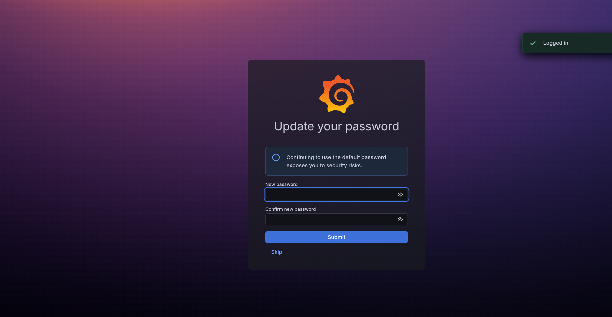

# Observability

Prometheus metrics, the Grafana dashboard, and what gets persisted to the
call/SMS database.

## Metrics endpoint

Prometheus-compatible metrics are served at `http://<host>:9091/metrics`
(port configurable via `[metrics].port`).

| Metric | Type | Description |
|---|---|---|
| `gsm_sip_bridge_calls_total` | Counter | Inbound calls by module, status, and **transport** (`cs` or `vowifi`) |
| `gsm_sip_bridge_sip_calls_total` | Counter | Outbound SIP calls by module, status, and **transport** |
| `gsm_sip_bridge_call_duration_seconds` | Histogram | Call duration distribution by module and **transport** (1s to 30min buckets) |
| `gsm_sip_bridge_active_calls` | Gauge | Currently active bridged calls per module and **transport** |
| `gsm_sip_bridge_sip_registrations_total` | Counter | SIP registration attempts by status (circuit-switched daemon's own PBX registration) |
| `gsm_sip_bridge_sip_registered` | Gauge | SIP registration state (1=registered, 0=unregistered) |
| `gsm_sip_bridge_module_init_total` | Counter | Module initialization attempts by status |
| `gsm_sip_bridge_module_retries_total` | Counter | Module retry attempts |
| `gsm_sip_bridge_modules_active` | Gauge | Number of active modules |
| `gsm_sip_bridge_modules_failed` | Gauge | Number of failed modules pending retry |
| `gsm_sip_bridge_audio_errors_total` | Counter | Audio errors by module and type |
| `gsm_sip_bridge_sms_received_total` | Counter | SMS messages received per module and **transport** |
| `gsm_sip_bridge_sms_forwarded_total` | Counter | Discord forwarding outcomes per module, outcome, and **transport** |
| `gsm_sip_bridge_sms_db_writes_total` | Counter | SMS database write outcomes |
| `gsm_sip_bridge_store_writes_total` | Counter | All store writes by table and outcome |
| `gsm_sip_bridge_store_queue_depth` | Gauge | Pending items for DB writer thread |
| `gsm_sip_bridge_uptime_seconds` | Gauge | Process uptime in seconds |
| `gsm_sip_bridge_build_info` | Gauge | Build metadata (version, git SHA) |
| `gsm_sip_bridge_vowifi_registered` | Gauge | 1 if the VoWiFi IMS registration is currently held |
| `gsm_sip_bridge_vowifi_registrations_total` | Counter | VoWiFi IMS registration attempts by outcome |
| `gsm_sip_bridge_vowifi_tunnel_up` | Gauge | 1 if Agent A has a P-CSCF assignment and a live transport to it — a liveness proxy, not raw IKE/ESP SA state |
| `gsm_sip_bridge_vowifi_child_sa_up` | Gauge | 1 if the supervisor's last check found a usable IPsec CHILD_SA for this VoWiFi line (`INSTALLED`, `REKEYING`, `REKEYED` or `UPDATING`), 0 otherwise. Unlike `vowifi_tunnel_up`, which is reported by the IMS agent and tracks registration liveness, this is the SA state as the supervisor sees it: it reads 0 from the start of supervision (while the tunnel is still establishing), and is zeroed when the supervisor's reports go stale (3× `[metrics].agent_report_interval_seconds`, 45s at the default 15s). Absent for swu-engine and VoLTE lines. Its reports also add an `agent_up{agent="supervisor"}` series per strongSwan line |
| `gsm_sip_bridge_vowifi_gm_connection_up` | Gauge | 1 if this line's Gm signaling connection is up, 0 while reconnecting or failed. Shared across VoWiFi and VoLTE lines, keyed by `module` (the `vowifi_` prefix is retained for VoLTE, matching `vowifi_tunnel_up`) |
| `gsm_sip_bridge_vowifi_bridge_failures_total` | Counter | Inbound VoWiFi calls that failed to bridge, by reason |
| `gsm_sip_bridge_vowifi_tunnel_recoveries_total` | Counter | Steady-state recoveries the supervisor performed on a strongSwan VoWiFi line, by **module** and **reason** (`process_died`, `vici_broken`, `tun_vanished`, `tun_unavailable`, `child_sa_missing`, `ike_sa_lost`, `child_sa_stuck`, `child_sa_rekey_stuck`, `pcscf_unreachable`, `default_route_missing`, `pcscf_pool_exhausted`). A series appears on a line's first recovery for that reason. Reported as one event per recovery, so it survives a supervisor restart. A rising `default_route_missing` count is a route that keeps vanishing: each repair restarts the IMS agent, but none counts toward the `tunnel_failure` flapping rule. Absent for swu-engine and VoLTE lines |
| `gsm_sip_bridge_vowifi_dead_peer_losses_total` | Counter | IKE_SA losses to an unresponsive ePDG on a strongSwan VoWiFi line (`ike_sa_lost` with a dead-peer cause), by **module** and **verdict**: `false` when inbound ESP arrived while charon was still retransmitting its unanswered request (the path worked again before charon gave up: either the ePDG ignored one IKE request, or a short local outage ended after charon's last retransmit), `real` when nothing arrived after the request could have gone out, `unknown` when the supervisor could not tell. Each loss also counts in `vowifi_tunnel_recoveries_total{reason="ike_sa_lost"}`. One event per loss, so it survives a supervisor restart. Absent for swu-engine and VoLTE lines |
| `gsm_sip_bridge_agent_up` | Gauge | 1 if the named VoWiFi agent (`ims` or `sip`) has reported within the last 3 report intervals |
| `gsm_sip_bridge_agent_last_report_seconds` | Gauge | Age of the named agent's most recent report |
| `gsm_sip_bridge_observability_events_dropped_total` | Counter | Reports an agent's bounded buffer discarded on overflow |
| `gsm_sip_bridge_critical_alerts_total` | Counter | Discord critical-alert dispatch outcomes by **category** (`sms`, `module_lifecycle`, `registration_loss`, `tunnel_failure`, `missed_call`, `line_discovery_failed`, `gm_connection_lost`, `pcscf_pool_exhausted`) and **outcome** (`sent`, `suppressed`, `skipped`, `failed`) — see `[alerts]` in [configuration.md](configuration.md) |
| `gsm_sip_bridge_critical_event_active` | Gauge | 1 while a `module_lifecycle`/`registration_loss`/`tunnel_failure`/`line_discovery_failed`/`gm_connection_lost`/`pcscf_pool_exhausted` category is in an active (unresolved) incident for a given module/line, by **category** and **module** |
| `gsm_sip_bridge_sip_server_bindings` | Gauge | IP phones currently registered to the embedded registrar (`[sip_server]` mode) |
| `gsm_sip_bridge_sip_server_ring_aor_registered` | Gauge | 1 when `[sip_server].ring_aor` specifically has a live registration — the gauge that answers "will a call ring?" |
| `gsm_sip_bridge_sip_server_registrations_total` | Counter | Registration attempts by **outcome** (`accepted`, `challenged`, `rejected_auth`, `rejected_unknown_user`, `rejected_stale`, `rejected_interval`, `deregistered`) |
| `gsm_sip_bridge_sip_server_requests_total` | Counter | Every request the registrar answered, by **method** and response **status** |
| `gsm_sip_bridge_sip_server_ring_target_missing_total` | Counter | Inbound calls dropped because no phone was registered to ring |
| `gsm_sip_bridge_outbound_attempts_total` | Counter | Outbound call attempts (`[outbound]` mode) by **outcome** (`placed`, `refused_no_idle_line`, `refused_invalid_destination`, `refused_network_failure`, `unanswered`) |

The `tunnel_failure` alert fires when **either** the IMS agent's tunnel signal or the CHILD_SA signal (`vowifi_child_sa_up`) has been unhealthy continuously for `unhealthy_sec`, once per outage, and recovers when both are healthy again.

**Lost default route** (strongswan engine, specs/096): on every healthy 30 s tick, before probing the P-CSCF, the supervisor checks that the line's namespace still has a default route through its tunnel in the current P-CSCF's address family. If it is gone, it reinstates it without renegotiating (`netns imsN has no IPv6 default route via tun23-N … reinstating it`, then `recovered from DefaultRouteMissing`) and restarts the line's IMS agent, which drops a call in progress. Each repair adds one to `vowifi_tunnel_recoveries_total{reason="default_route_missing"}`.

**Every P-CSCF given up on** (both engines, specs/097): right after the route check, and before the probe, the supervisor reads the IMS agent's P-CSCF state (`/tmp/pcscf-N.state`). If the agent has marked every P-CSCF in the line's pool unavailable since the tunnel was last negotiated — three unanswered Gm keepalives or a REGISTER that timed out, not a `503` `Retry-After` — the supervisor rebuilds the tunnel to get a new P-CSCF. It logs `the IMS agent marked every P-CSCF unavailable since the negotiation at …: <addr> (<cause>, marked …, until …)`, then `recovered from PcscfPoolExhausted`. This is what recovers a carrier with a single P-CSCF, where the agent has no sibling to fail over to. The agent's verdict wins over a passing probe. While a call is in progress the rebuild waits, however long the call lasts (`deferring the tunnel rebuild while a call is active`). A carrier that keeps handing out the same dead P-CSCF is rebuilt again on each new mark, with no backoff, and the `pcscf_pool_exhausted` alert fires once that has gone on for `unhealthy_sec` (see [configuration.md](configuration.md)). The counter and the alert are strongSwan only; the swu loop rebuilds without reporting.

**Dead-peer losses** (strongswan engine, specs/098): when charon gives up on an ePDG that stopped answering IKE (`giving up after 5 retransmits`, ~165s after the first unanswered request), the supervisor sees the IKE_SA gone on its next tick and re-initiates (`recovered from IkeSaLost (cause: dead-peer timeout)`). It then logs a verdict from the inbound ESP its previous healthy tick saw: `dead peer verdict: false (inbound ESP 42s before the loss, 1834 packets, snapshot 12s old; charon retransmits for 165s)`. `false` means traffic from the ePDG arrived again before charon gave up (the ePDG ignored the IKE exchange, or a short outage on this host's side ended); `real` means the path stayed dead. The DPD delay is `[vowifi].dpd_delay_sec` (default 120s); while the supervisor's P-CSCF probe runs, its traffic keeps DPD from firing at all.

**Uplink holds** (strongswan engine, specs/100): while the path from this host to a line's ePDG is down, the supervisor holds back the recoveries that are only inferred from the ePDG being unreachable. `gsm_sip_bridge_vowifi_uplink_holds_total{module,cause}` counts each hold by cause (`no_route`, `no_response`), `gsm_sip_bridge_vowifi_uplink_held_seconds_total{module,cause}` adds up the time spent held when each hold ends, and `gsm_sip_bridge_vowifi_uplink_held{module}` is 1 while one is in progress (it reads 0 once the supervisor goes quiet). The tunnel-failure alert is unchanged except that, if it fires on a held line, its text ends `; uplink down (no route), recovery on hold`. Two existing counters gain a label value: `gsm_sip_bridge_vowifi_tunnel_recoveries_total{reason="ike_sa_negotiation_stuck"}` for a half-open IKE_SA charon stopped working on, and `gsm_sip_bridge_vowifi_dead_peer_losses_total{verdict="uplink"}` for a dead-peer loss seen while held, which is never counted as `real`. See [operations.md](operations.md#vowifi-uplink-down--holding-tunnel-recovery).

**Stuck CHILD_SA rekey** (strongswan engine, specs/093): a CHILD_SA is normally rekeyed with 6 to 12 minutes of its lifetime left. If the same CHILD_SA is still in place with under 5 minutes left, its rekey has failed (the ePDG refused or ignored it), and the supervisor rebuilds the tunnel then, while the old CHILD_SA still carries traffic, instead of letting it expire. The log shows `[supervise] line N: imsN CHILD_SA #M rekey overdue (expires in Ss[, last rejection N(...)]); rebuilding before the hard expiry`, then `recovered from ChildSaRekeyStuck`. While the line has a call in progress the rebuild waits (`deferring the rebuild while a call is active`) until the call ends or 90 seconds remain. Each rebuild counts toward the `tunnel_failure` flapping rule like any other. A line that logs this every hour has a carrier rejecting its rekeys; on an IPv4-only ePDG that logs `N(INVAL_SEL)`, set `tunnel_address_family = "ipv4"` (see [configuration.md](configuration.md)).

**SIP server mode gauges**: `sip_server_*` appear only when
`[sip_server].enabled` (see [configuration.md](configuration.md)).

The registrar is hosted by whichever process owns the SIP side, and on the
VoWiFi/VoLTE paths that is a telephony agent which serves no `/metrics` of its
own. `bindings` and `ring_aor_registered` therefore reach the daemon's endpoint
over the same agent-reporting channel the VoWiFi gauges use, so they lag by up
to `[metrics].agent_report_interval_seconds`. The two counters
(`registrations_total`, `requests_total`) are per-request and are **only
exported when the circuit-switched daemon hosts the registrar** — on a
VoWiFi/VoLTE deployment, read the refusal reasons from the agent's logs
(`sip_server: refusing a registration`) instead.

The gauges are deliberately separate series from `sip_registered` and
`volte_registered`, for the same reason those two are separate from each other:
an operator needs to see *which* registration is down, not an aggregate that
hides it.

`bindings` and `ring_aor_registered` answer different questions —
`bindings` can be nonzero while the *ringing* account specifically is absent, in
which case calls do not ring. Alert on `ring_aor_registered`, not on `bindings`.

One `registrations_total{outcome="challenged"}` per `accepted` is normal:
every REGISTER is challenged once and succeeds on the retry. A rising
`rejected_auth` means wrong credentials on a handset;
`rejected_unknown_user` means it is claiming an account that is not
configured. The two are answered identically on the wire, so that
distinction exists only here.

`ring_target_missing_total` is counted apart from
`sip_calls_total{status="error"}` because the remedy differs: the bridge is
healthy, the handset is not there.

**Transport label**: the six metrics marked **transport** above carry
`transport="cs"` for the circuit-switched daemon and `transport="vowifi"`
for the two VoWiFi agents (`ims::agent`, `vowifi::mod`) — one metric family
per call/SMS concept, with the two paths distinguishable rather than
invisible to each other. Existing dashboard queries that don't constrain
`transport` see the combined total, unchanged in value from before VoWiFi
existed on a circuit-switched-only deployment.

**Module identity across transports**: when the same physical modem serves
both circuit-switched voice and VoWiFi, its `module` label is identical on
both transports (resolved via `modules::discovery::derive_module_id`/
`resolve_module_id_for_port` from the modem's USB serial either way), so a
per-module panel shows that card's complete traffic. VoWiFi metrics fall
back to the literal `module="vowifi"` only if the card's USB serial can't be
resolved.

**How VoWiFi metrics reach this endpoint**: `ims::agent` and `vowifi::mod`
run in separate processes/network namespaces and serve no scrape endpoint
of their own. Each reports call/SMS/health events to the daemon over the
same Unix control socket the CLI uses (`ControlCmd::Observe`), buffered
locally (bounded, 1024 reports) if the daemon is briefly unreachable so a
routine daemon restart doesn't lose in-flight events. See
`specs/014-vowifi-metrics-restore/contracts/observability-protocol.md` for
the wire format.

## Reg-event NOTIFY logs

Every reg-event `NOTIFY` the IMS agent receives (VoWiFi and VoLTE alike) logs
one line saying what it meant for the line's current binding (specs/089). The
field names are stable; grep for them.

| Field | Example | Meaning |
|---|---|---|
| `attribution` | `contact-addr` | How the line's current entries were found: `contact-addr` (the address it registered), `imei` (IMEI echoed on an entry with no address), `sole-contact` or `none` |
| `contact_addr` | `10.0.0.1:5070` | The address the current registration advertised |
| `own_entries` | `2` | Entries for the current binding (one per public identity) |
| `retired_entries` | `1` | Entries echoing the IMEI at another address: a binding a renewal replaced |
| `contact_states` | `active/registered` | `state/event` of each current entry |
| `applied` | `rejected` | The event acted on, the most restrictive one (`deactivated`, `unregistered`, `probation`, `rejected`), or `none` |
| `retry_after_secs` | `600` | The longest `retry-after` the network gave, when present |
| `scope` | `binding-removed` | When an event is applied: `identity-deregistered` (the whole public identity) or `binding-removed` (only this binding) |
| `subscription_state` | `active;expires=600000` | The `Subscription-State` header, verbatim |
| `body` | reginfo XML | The full document |

Messages:

- `reg-event NOTIFY: our current binding was deregistered` (WARN): an event was applied.
- `reg-event NOTIFY for our binding` (INFO): the current binding is listed and nothing changed.
- `reg-event NOTIFY, nothing attributable to our current binding` (INFO): none of the entries is the current binding.
- `replaced binding retired` (INFO, one per entry, with `retired_addr`, `state`, `event` and `contact_addr`): the network retired a binding a renewal replaced. Expected about once per renewal on carriers that do this; never acted on.

What the agent then does is logged as one of:

- `re-registering now: the network deactivated our binding` (`registered_secs_ago`, `counted`)
- `the network dropped our binding; retrying on backoff` (`event`, `registered_secs_ago`, `retry_in_secs`)
- `the network rejected our registration; holding off` (`cooldown_secs`, `retry_after_secs`, `next_attempt_at`), then `ending call: the network rejected our registration` if a call was up, and `rejection cooldown over; trying to register once` when the cooldown ends

During a rejection cooldown, `vowifi-status`/`volte-status` read `state: Failed`,
`can_answer: false`, and `rejection_cooldown: until <time> (next attempt in <N>s)`;
otherwise `rejection_cooldown: none`.

## Reg-event subscription logs

The reg-event `SUBSCRIBE` is tracked as a transaction and a dialog (specs/090),
identically on VoWiFi and VoLTE. Every SUBSCRIBE response and every NOTIFY
produces one line naming which subscription it belongs to: the current one, one
a renewal replaced (`superseded`), or none of ours (`unknown`).

| Message | Level | Fields |
|---|---|---|
| `sent reg-event SUBSCRIBE` | INFO | `impu`, `call_id`, `cseq`, `kind` (`initial`/`refresh`), `expires` |
| `failed to send reg-event SUBSCRIBE` | WARN | `error`, `call_id`, `kind` |
| `reg-event SUBSCRIBE accepted` | INFO | `call_id`, `cseq`, `status`, `granted_expires`, `kind` |
| `reg-event SUBSCRIBE interval too brief; resending` | INFO | `call_id`, `min_expires` |
| `the network does not support the reg event package; not subscribing again for this registration` | WARN | `call_id` |
| `reg-event SUBSCRIBE refused; retrying on backoff` | WARN | `call_id`, `status`, `reason`, `retry_in_secs`, `kind` |
| `response to a superseded reg-event SUBSCRIBE; ignored` / `response to an unknown reg-event SUBSCRIBE; ignored` | INFO | `call_id`, `cseq`, `status` |
| `reg-event subscription confirmed` | INFO | `call_id`, `expires_in_secs` |
| `reg-event subscription accepted but never confirmed; retrying on backoff` | WARN | `call_id`, `retry_in_secs` (no NOTIFY within 128 s) |
| `reg-event subscription terminated by the network` | WARN | `call_id`, `reason`, `retry_after_secs`, `next` (`now`/`backoff`/`after-retry-after`/`next-registration`), `retry_in_secs` |
| `reg-event subscription expired without a successful refresh; resubscribing` | WARN | `call_id` |
| `NOTIFY for a superseded reg-event subscription; acknowledged, not applied` | INFO | `call_id`, `subscription_state`, `attribution`, `own_entries`, `contact_states`, `body` |
| `NOTIFY for no subscription of ours; refused 481` | INFO | `call_id`, `to_tag`, `event`, `subscription_state`, `current_call_id`, `current_local_tag` |
| `NOTIFY without Subscription-State; treating as active` | WARN | `call_id` |

The NOTIFY lines in the section above apply to the current subscription only, and
carry `subscription=current`.

A SUBSCRIBE with no final response within 128 s (Timer F), or one that could not
be sent, is checked with one immediate Gm keepalive probe, even during a call:

| Message | Level | Fields |
|---|---|---|
| `reg-event SUBSCRIBE unanswered; probing the Gm path` | WARN | `call_id`, `cause` (`subscribe-timeout`/`subscribe-send-failed`), `in_call` |
| `Gm path answered; reg-event subscription failed, retrying on backoff` | WARN | `call_id`, `retry_in_secs` |
| `qualifying endpoint failure: re-registering` | WARN | `cause`, `call_id`, `in_call` |
| `qualifying endpoint failure while a re-registration is already pending` | INFO | `cause`, `call_id` |

A qualifying endpoint failure re-registers at once, skipping the transport
rebuild ladder; during a call the re-registration waits for the call to end, and
the call is not dropped. Status reads `state: Failed`, `gm_connection: failed
since <time>`, and `last_failure: reg-event SUBSCRIBE unanswered and the Gm
keepalive probe failed; re-registering`.

Subscription retries use their own backoff (5 s doubling to 600 s, never sooner
than a network `Retry-After`), separate from registration renewal's, and never
count against the renewal budget.

`vowifi-status`/`volte-status` print two lines after `gm_connection`:

```text
    reg_subscription: confirmed, expires 2026-10-14T11:02:11+00:00
    reg_subscription_last_failure: none
```

`reg_subscription` is one of `none`, `pending since <time>`, `confirmed, expires
<time>`, `unconfirmed since <time>[; retry at <time>]` or `stopped until next
registration (<reason>)`. `reg_subscription_last_failure` keeps the most recent
subscription failure even after a later success: `accepted but no NOTIFY within
128s`, `SUBSCRIBE unanswered within 128s (Gm path alive)`, `SUBSCRIBE could not be
sent (Gm path alive)`, `SUBSCRIBE refused: <status> <reason>`, `terminated by the
network: <reason>` or `expired without a successful refresh`. Neither line changes
`can_answer`. An older agent that does not report them prints `unknown`.

## P-CSCF selection and failover

A VoWiFi tunnel negotiation advertises several P-CSCFs, often two to four. The
supervisor still picks one of them deterministically into `/tmp/pcscf-N` (a
reorder of the same set never restarts a line). It also publishes the whole list
to `/tmp/pcscf-N.pool`, and rewrites that file alone when the set changes on a
healthy line (specs/091).

The IMS agent registers through one candidate at a time. The candidates are tried
in this order:

1. the last P-CSCF that registered successfully;
2. the supervisor's choice;
3. the rest of the pool, IPv4 before IPv6.

When the P-CSCF itself fails while the tunnel is up, the agent marks it
unavailable and registers through the next candidate straight away. These
failures count:

- a REGISTER that times out;
- a connect that is refused or times out;
- a send that fails on a new connection;
- a reg-event SUBSCRIBE that goes unanswered, followed by an unanswered Gm probe;
- the Gm keepalive escalation;
- a `503` whose `Retry-After` is longer than 128 s.

A mark lasts 330 s after the first failure, doubling up to 2100 s on repeated
failures. A `503` mark lasts the `Retry-After` period instead. A successful
registration through an address clears its mark and resets its failure count.

These never mark a P-CSCF:

- `Network is unreachable` or no route, which means the tunnel is down; the agent
  checks the route as well as the error;
- the P-CSCF closing a connection;
- any SIM or authentication failure;
- any other final response;
- a reg-event deregistration (including `rejected`);
- a failure on an address the line has already moved away from.

When every candidate is marked, the line uses its usual renewal backoff, each
step going to the address whose mark ends soonest, and the usual retry budget
still restarts the agent. The supervisor rebuilds the tunnel only when no pool
member answers at all; the new negotiation brings a new pool. Marks and the last
working P-CSCF are kept in `/tmp/pcscf-N.state`, so an agent restart honours them.
VoLTE lines run the same logic over their single configured P-CSCF, kept in
`/tmp/volte-pcscf-<card>.state`.

| Message | Level | Fields |
|---|---|---|
| `P-CSCF selected` | INFO | `pcscf`, `reason` (`startup`/`sticky`/`failover`/`pool-replaced`/`all-unavailable`), `cause`, `previous`, `candidates` |
| `registration through P-CSCF` | INFO / WARN | `pcscf`, `outcome` (`registered`/`failed`), `class` (`timeout`/`transport`/`no-route`/`peer-closed`/`not-pcscf`/`rejected`), `status`, `error` |
| `P-CSCF marked unavailable` | WARN | `pcscf`, `cause`, `failures`, `until`, `unavailable_secs`, `remaining` |
| `failing over to the next P-CSCF now` | WARN | `from`, `to`, `cause` |
| `every P-CSCF is unavailable; retrying on backoff` | WARN | `pcscf`, `pool`, `retry_in_secs` |
| `every P-CSCF is unavailable; waiting before the startup attempt` | WARN | `pcscf`, `wait_secs` |
| `failure not attributed to the P-CSCF; not marking` | INFO | `pcscf`, `cause`, `why` (`no-route`/`not-active`) |
| `P-CSCF pool replaced` | INFO | `pool`, `dropped_marks` |
| `P-CSCF state unreadable; starting clean` / `could not save P-CSCF state` | WARN | `path`, `error` |

The supervisor adds `P-CSCF pool: …` when it publishes a pool,
`P-CSCF pool changed (set): …; not restarting`, and
`P-CSCF <a> unreachable; pool member <b> answers` when it holds off a tunnel
rebuild because another pool member still answers.

`vowifi-status`/`volte-status` print two lines after `reg_subscription_last_failure`:

```text
    pcscf: 10.0.1.10 (pool: 10.0.1.10, 10.0.0.10)
    pcscf_unavailable: 10.0.0.10 until 2026-10-14T10:08:41+00:00
```

To forget every mark on a line, delete `/tmp/pcscf-N.state` and restart its agent.

## Grafana dashboard

The "GSM-SIP Bridge" dashboard is auto-provisioned on first boot of the
Docker Compose stack (credentials: `admin` / `admin`).



Dashboard panels include:

- System overview (SIP registration, active modules, uptime, call counts)
- GSM and SIP call rates over time
- Active calls per module
- Call duration percentiles (p50/p95/p99)
- SIP registration state timeline
- Module health and retry counts
- Audio and SIP error rates
- SMS forwarding success/failure rates
- VoWiFi IMS registration and ePDG tunnel state
- VoWiFi bridge failures by reason
- VoWiFi agent liveness and dropped-event counts

## Call and SMS database

All incoming calls and SMS messages are persisted to the SQLite database
(WAL mode for concurrent access). In the Docker Compose stack, sqlite-web
serves a read-only browser for it at `http://localhost:8088`. For direct
`sqlite3` queries, pruning, and backup recipes see
[operations.md](operations.md).

**Calls table**:

| Column | Description |
|---|---|
| `module_id` | Card identifier (e.g., `ec20-A1B2C3`) |
| `caller_id` | Caller's phone number |
| `started_at` | ISO 8601 timestamp (UTC) — the moment of answer for an answered call, the moment the call arrived otherwise |
| `duration_seconds` | Call duration in seconds (0.0 for missed/failed calls) |
| `status` | `answered`, `missed`, or `failed` |
| `sip_destination` | SIP extension dialed (empty for missed/failed calls) |
| `transport` | `cs` (circuit-switched) or `vowifi`. Rows written before this column existed were backfilled as `cs` — accurate by construction, since the VoWiFi path had never written a row before it existed. |

**SMS table**:

| Column | Description |
|---|---|
| `module_id` | Card identifier |
| `sender` | SMS sender number |
| `body` | Message text |
| `received_at` | ISO 8601 timestamp (UTC) |
| `forwarding_status` | `pending`, `sent`, `failed`, or `skipped` |
| `transport` | `cs` or `vowifi`, same semantics and backfill as the calls table |

**card_slots table** (IMEI→slot mapping, persisted across restarts):

| Column | Description |
|---|---|
| `slot` | Slot index (0-based, stable for the life of the hardware) |
| `imei` | 15-digit IMEI uniquely identifying the physical modem |
| `assigned_at` | ISO 8601 timestamp when the slot was first assigned |

**card_mode_prefs table** (per-slot network mode preference):

| Column | Description |
|---|---|
| `slot` | Slot index |
| `mode` | Network mode: `auto`, `2g`, `3g`, or `4g` |
| `updated_at` | ISO 8601 timestamp of the last `card set-mode` call |
